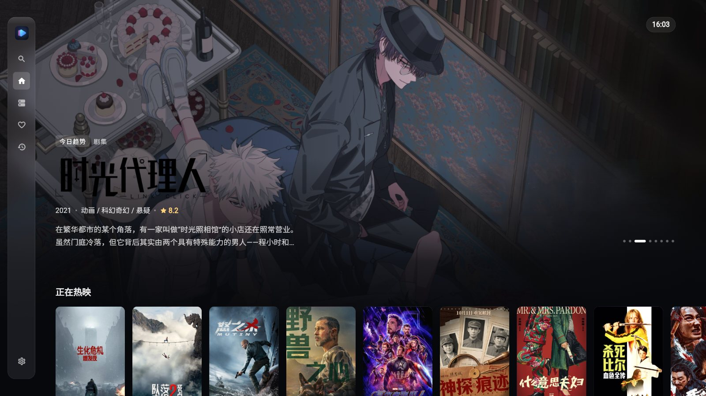
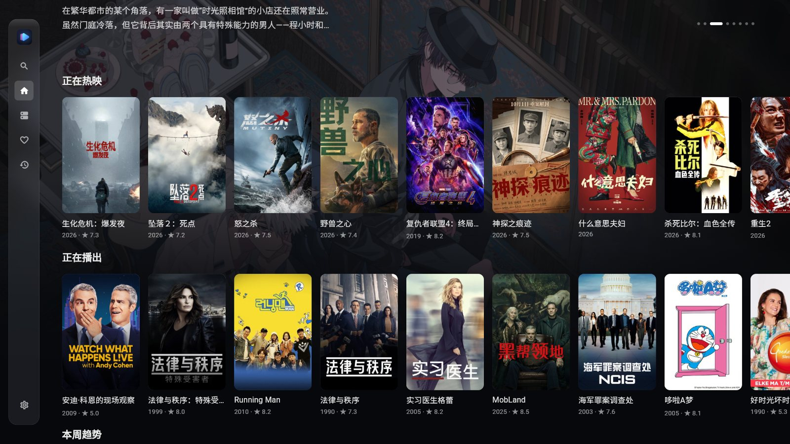
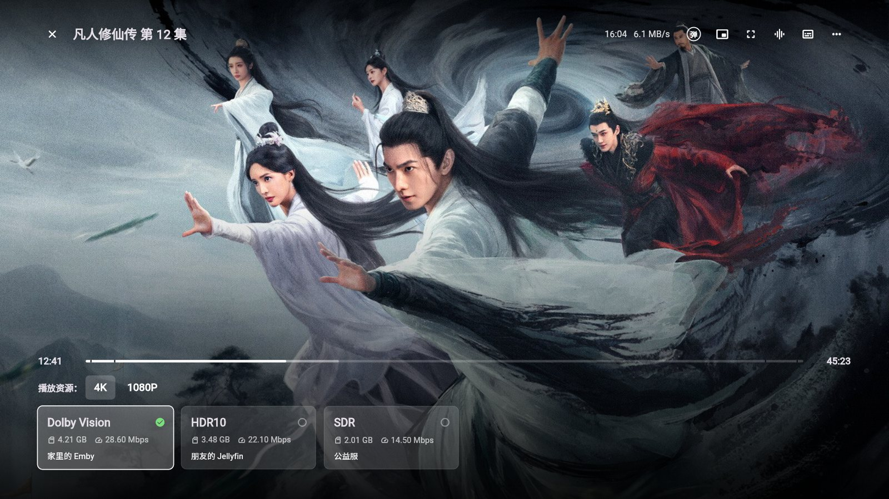
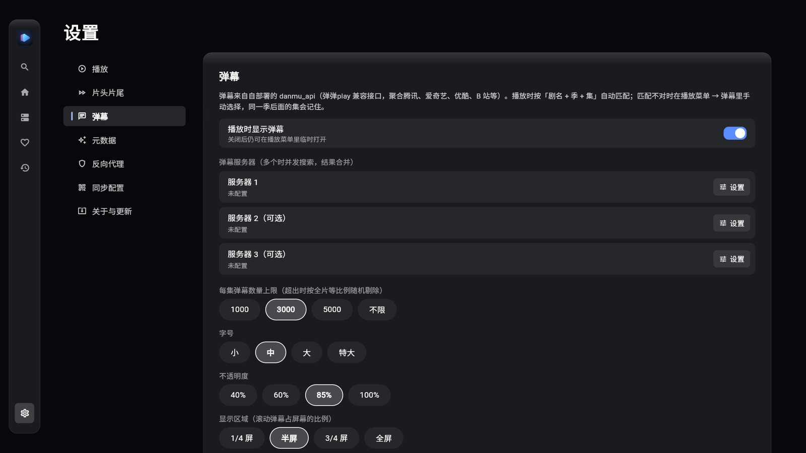
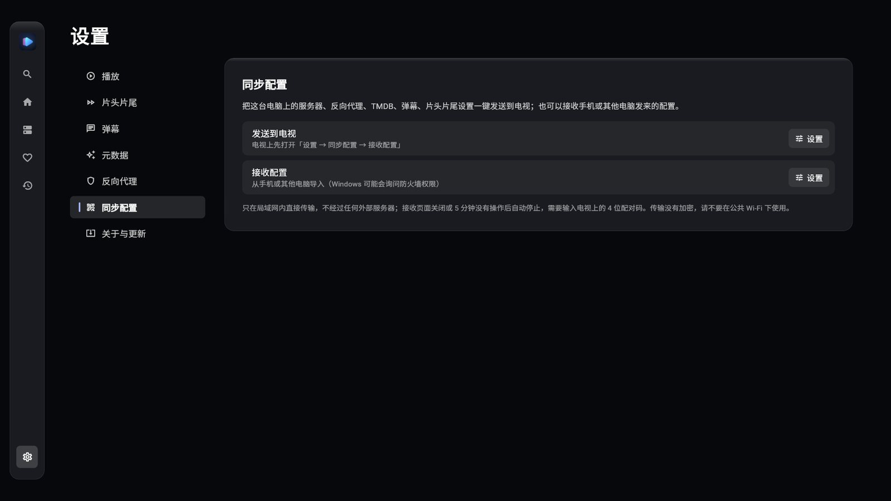
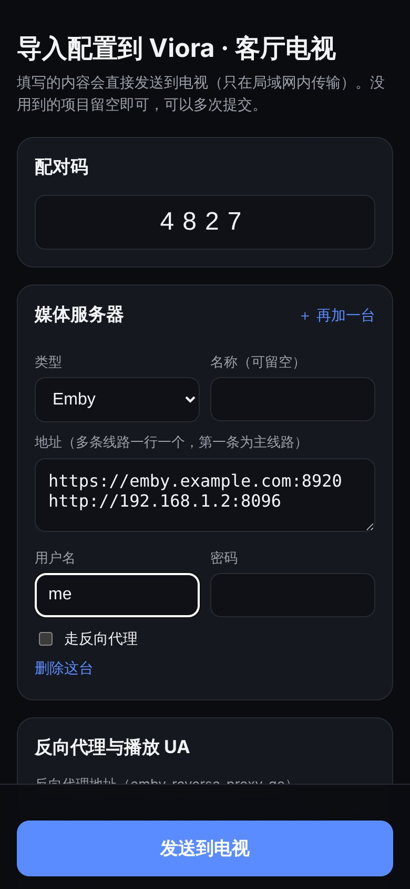

# Viora

为大屏打造的家庭影音播放器，支持 **Android TV** 和 **Windows**。

把你的 Emby / Jellyfin 服务器（可以多台）连起来，所有片子合成一个片库：首页有 TMDB 的热门推荐，详情页能看到每台服务器上的不同版本，播放时可以跳过片头片尾、开弹幕，用遥控器或键鼠都顺手。

> Plex、飞牛影视（fnOS）在计划中，暂不支持。



## 界面预览

<table>
  <tr>
    <td><br><sub>首页：TMDB 推荐与继续观看</sub></td>
    <td><br><sub>详情页：进入后在所有服务器上查找资源</sub></td>
  </tr>
  <tr>
    <td><br><sub>播放：进度条标出片头片尾，右上角显示网速</sub></td>
    <td><br><sub>播放中切换服务器 / 版本</sub></td>
  </tr>
  <tr>
    <td><br><sub>弹幕</sub></td>
    <td><br><sub>设置：弹幕服务器与显示样式</sub></td>
  </tr>
</table>

> 截图中的影视海报与剧照来自 TMDB，仅作界面展示。

## 下载安装

到 [Releases](../../releases) 下载最新版本（目前是测试版）：

| 文件 | 适用 |
| --- | --- |
| `Viora-<版本>-android.apk` | Android TV / 电视盒子 / Android 设备 |
| `Viora-<版本>-windows-setup.exe` | Windows 安装版（推荐，支持应用内自动更新） |
| `Viora-<版本>-windows-portable.zip` | Windows 免安装版，解压即用 |

- **Android TV**：用 U 盘、当贝助手或「发送文件到电视」把 APK 传到电视上安装，第一次需要允许「安装未知应用」。
- **自动更新**：启动后会自动检查新版本，也可以在「设置 → 关于与更新」手动检查。Windows 会自动安装并重新打开；Android 会弹出系统安装界面。

## 快速开始

### 1. 添加服务器

**在电脑上**：资源库 → 添加服务器，选择 Emby 或 Jellyfin，填写地址、用户名和密码。一台服务器可以填多条线路（比如内网地址和外网地址），Viora 会自动测速选最快的线路。

**在电视上**（推荐用同步，不用遥控器打字）：

1. 电视上打开「设置 → 同步配置 → 接收配置」，屏幕上会显示二维码和 4 位配对码。
2. 二选一：
   - **用手机**：扫码打开网页，填写服务器、反向代理、TMDB Key、弹幕服务器等，点「发送到电视」。
   - **用 Windows 版 Viora**：「设置 → 同步配置 → 发送到电视」，选中找到的电视，输入配对码，把电脑上的配置一次推过去。
3. 电视收到后会自动登录、测速并同步片库。

**多台设备保持一致**：在「设置 → 同步配置 → WebDAV 同步」填写 WebDAV 地址（坚果云、群晖、Alist 等），每台设备填同一个地址，
之后在任何一台上添加 / 删除服务器、修改设置，其他设备启动时会自动同步。建议设置加密口令（所有设备一致），云端文件就不会明文保存服务器密码。

> 局域网同步只在局域网内直接传输，不经过任何外部服务器；接收页面关闭或 5 分钟没有操作会自动停止。请不要在公共 Wi-Fi 下使用。

<table>
  <tr>
    <td width="68%"><br><sub>设置 → 同步配置</sub></td>
    <td width="32%"><br><sub>手机扫码后填写配置</sub></td>
  </tr>
</table>

### 2. 开始看

- **首页**：TMDB 今日趋势、正在热映、热门剧集等推荐，以及你的「继续观看」和「最近入库」。
- **详情页**：进入后自动在所有服务器上查找这部片子。可以直接播放，也可以选择某台服务器、某个版本（4K / 1080P、HDR / 杜比视界）。
- **资源库**：按服务器、按媒体库浏览；「收藏」「观看记录」汇总所有服务器的内容。
- **搜索**：支持中文、拼音首字母、全拼，同时搜所有服务器。

## 播放

- **继续观看**：自动从上次的位置开始，进度同步回服务器，在其他设备上也能接着看。
- **切换版本**：播放中点右下角的清晰度（如「4K」），可以换到其他服务器或其他版本，从当前进度接着播。
- **选集**：剧集播放时右下角「选集」查看本季所有集，看到快结束时会预加载下一集。
- **跳过片头片尾**：出现「跳过片头」「下一集」按钮时按 OK 即可；也可以设置为自动跳过。数据来自媒体服务器的片段标记、章节，以及 TheIntroDB / IntroDB 等在线数据库。
- **音轨 / 字幕 / 倍速**：控制栏上直接切换，支持外挂字幕。
- **弹幕**：右上角「弹」开关，需要先配置弹幕服务器（见下文）。
- **网速**：右上角实时显示下载速度。
- **Windows 专属**：小窗播放（置顶在屏幕右下角）、全屏、拖动进度条。

### Android TV 遥控器

| 按键 | 作用 |
| --- | --- |
| 方向键 | 移动焦点；播放时 ←→ 快退 / 快进（长按加速） |
| OK | 确认；播放时暂停 / 继续，出现跳过按钮时执行跳过 |
| ↓（播放时） | 进入底部按钮：清晰度、选集、倍速等 |
| 菜单键 / 长按 OK | 打开菜单（播放时为播放设置） |
| 返回 | 一层层返回（按住不放不会连续返回） |
| 长按返回 3 秒 | 弹出「退出 Viora？」确认，选「退出」才退出 |
| 最左侧再按 ← | 打开侧边导航栏 |

### Windows 键鼠

| 操作 | 作用 |
| --- | --- |
| 鼠标悬停 / 点击 | 选中 / 打开；右键打开菜单 |
| 空格 / K | 暂停 / 继续 |
| ← → / J L | 快退 / 快进 |
| F 或双击画面、F11 | 全屏 |
| P | 小窗播放 |
| N | 下一集 |
| D | 弹幕开关 |
| A / C | 切换音轨 / 字幕 |
| Esc / 鼠标侧键 | 返回 |

## 设置

| 分类 | 可以做什么 |
| --- | --- |
| 播放 | 播放 UA、客户端名称、播放预加载、缓冲大小、快进步长；电视上可选播放内核（ExoPlayer / mpv）、自动帧率、隧道播放 |
| 片头片尾 | 各数据源开关与 API Key，片头 / 片尾 / 前情提要分别设为显示按钮或自动跳过 |
| 弹幕 | 弹幕服务器（最多 3 个）、数量上限、字号、透明度、显示区域、速度、繁简转换、颜色、屏蔽词 |
| 元数据 | TMDB API Key（已内置可直接用），可通过反向代理访问 TMDB |
| 反向代理 | 填写代理地址后，可以让指定线路走代理访问 |
| 聚合搜索 | 选择哪些服务器参与跨服务器查找资源 |
| 同步配置 | 接收配置（电视 / 电脑）、发送到电视（Windows）、WebDAV 同步、配置备份 |
| 关于与更新 | 版本信息、检查更新、自定义更新地址 |

### 弹幕

弹幕来自自部署的 [danmu_api](https://github.com/huangxd-/danmu_api)（聚合腾讯、爱奇艺、优酷、B 站等平台）。部署后在「设置 → 弹幕」填写地址，格式为 `https://你的域名/token`。

播放时会按「剧名 + 季 + 集」自动匹配弹幕。匹配不对时，在播放菜单 → 弹幕里手动搜索并选择，同一季后面的集会自动记住；也可以调整弹幕的时间偏移。

## 常见问题

**电视上看起来卡？**
电视版已经关闭了磨砂模糊等耗性能的效果。如果仍然卡顿，可以在「设置 → 播放」降低播放缓冲上限，或换用另一个播放内核试试。

**无法播放 / 提示 403？**
部分服务器会限制客户端，在「设置 → 播放」修改播放 UA 或客户端名称，或在服务器设置里单独指定 UA。

**添加服务器失败，但别的播放器能登录？**
- 提示「服务器拒绝了这个客户端」：服务器只允许特定播放器（UA 白名单）。在添加服务器页的「UA」里填写能正常使用的播放器 UA（如 `Forward/1.0`、`SenPlayer/5.0`，具体问服主），这台服务器的登录、浏览、播放都会使用它。
- 提示「设备数已达上限」：账号限制了设备数量，在其他设备上退出登录或请服主清理旧设备。Viora 在同一台电视 / 电脑上重新添加同一个账号不会多占设备。

**连不上服务器？**
在资源库里对服务器测速，看看哪条线路可用；外网访问不稳定时可以配置反向代理。

**弹幕没有出来？**
确认已填写弹幕服务器；在播放菜单 → 弹幕 → 重新自动匹配，或手动搜索选择。

## 开发者

技术设计与开发说明见 [docs/](docs/)：

| 文档 | 内容 |
| --- | --- |
| [01-overview](docs/01-overview.md) | 产品定位、功能范围、技术选型 |
| [02-architecture](docs/02-architecture.md) | 工程结构与数据模型 |
| [03-media-servers](docs/03-media-servers.md) | 媒体服务器适配、多线路、反向代理、UA |
| [04-aggregation](docs/04-aggregation.md) | 聚合索引、聚合搜索、多版本选择 |
| [05-metadata-and-segments](docs/05-metadata-and-segments.md) | 元数据、TMDB、片头片尾 |
| [06-ui-design](docs/06-ui-design.md) | 大屏设计规范 |
| [07-input-control](docs/07-input-control.md) | 遥控器与键鼠、焦点系统 |
| [08-player](docs/08-player.md) | 播放内核与播放界面 |
| [09-roadmap](docs/09-roadmap.md) | 里程碑 |
| [10-danmaku](docs/10-danmaku.md) | 弹幕 |
| [11-sync](docs/11-sync.md) | 局域网同步配置 |

```bash
flutter pub get
flutter run -d windows   # Windows
flutter run              # Android TV（adb connect <电视IP>:5555 后可见）
flutter test
flutter analyze
```

把 `pubspec.yaml` 的 `version` 改大后合并到 main，CI（`.github/workflows/release.yml`，只在 main 上运行）会自动构建 APK 与 Windows 安装包并发布预发布版本。
